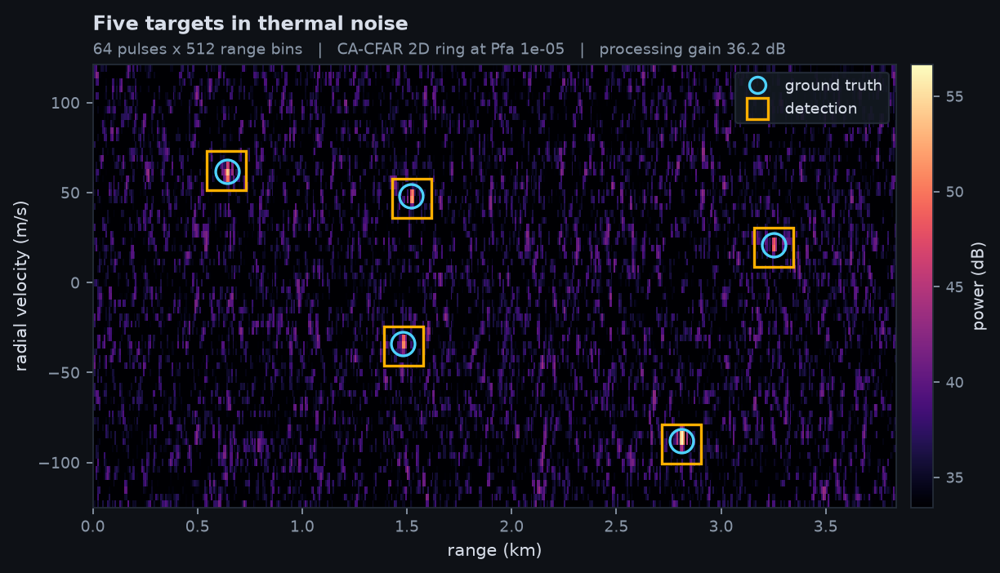
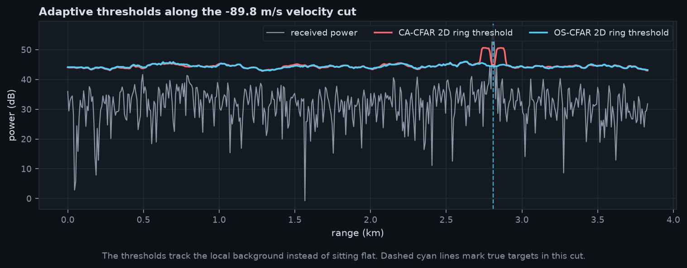
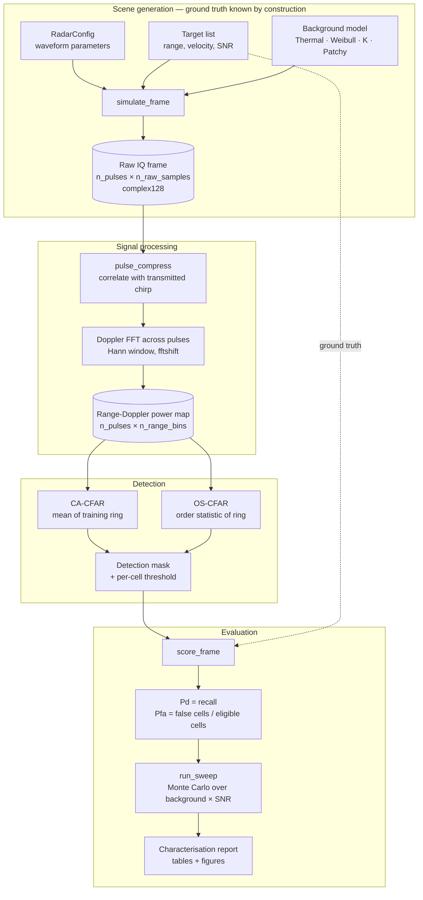

<div align="center">

# radar-cfar-testbench

**A test and evaluation bench for radar detection algorithms.**

Generates radar scenes with exactly known ground truth, runs detectors over them,
and measures where they break.

[](https://github.com/PARAxATHARV/radar-cfar-testbench/actions/workflows/ci.yml)




<sub>Five targets in thermal noise. Cyan circles are ground truth, amber squares are
detections. A square around a circle is a hit, a bare circle a miss, a bare square a
false alarm.</sub>

</div>

---

## The point

A radar detector is usually shown off with a picture: a range-Doppler map, some bright
blobs, arrows pointing at them. That demonstrates nothing — every detector finds a
strong target in clean noise.

The questions that decide whether a detector is usable are harder, and all three need
*measurement* rather than a screenshot:

- How faint can a target get before it is missed?
- Does the false-alarm rate hold at its design value, or quietly inflate?
- What kind of background breaks it, and by how much?

So the output here is not a detector claiming to be good. It is a **characterisation**,
regenerated from code on every run: detection curves against signal strength at a fixed
false-alarm rate, across backgrounds of increasing statistical nastiness, plus the
false-alarm rate each detector *actually achieved* versus the one it promised.

---

## Headline result

Two background estimators (mean vs order statistic) crossed with two training
geometries (a 2D ring vs range-only), measured across four backgrounds.

<!-- RESULTS-SUMMARY -->

**Achieved false-alarm rate, divided by the rate each detector was designed for.** 1.0 is a kept promise; **bold** broke its contract by 2x or more.

| Background | CA-CFAR, 2D ring | OS-CFAR, 2D ring | CA-CFAR, range-only | OS-CFAR, range-only |
|---|---|---|---|---|
| thermal (Gaussian) | 1.2x | 1.2x | 1.8x | **2.1x** |
| Weibull (shape 1.2) | 1.2x | 1.2x | 1.8x | **2.2x** |
| K-distributed (shape 0.5) | 1.2x | 1.2x | 1.7x | **2.1x** |
| patchy clutter (CNR 20 dB) | **23x** | **67x** | 1.6x | 1.9x |

Three results, none of them the textbook expectation:

1. **Independent heavy tails did not matter.** Weibull and K-distributed backgrounds are far spikier than Gaussian at the input, yet every detector held its contract. Pulse compression sums ~100 samples and the Doppler FFT sums the pulses; adding that many independent values drives the result toward a Gaussian whatever went in. The tail is averaged away before any detector sees it.
2. **Correlated clutter broke both estimators — and the order statistic was the worse choice, not the better one.** Clutter that persists across a dwell survives coherent processing as a ridge a few Doppler bins tall. A training ring thirteen cells tall then samples mostly clutter-free cells, so a 75th-percentile estimate reads that quiet majority and sets a threshold far too low for a cell inside the ridge.
3. **Training geometry mattered more than the choice of statistic.** Restricting training cells to the cell under test's own Doppler bin — so every training cell sees the same clutter level — brought both detectors back inside their contract. That is a larger effect than the difference between the two estimators, and it is what real surveillance radars do.

<sub>Design Pfa 1e-03, 60 trials per point, seed 20261010. Generated by <code>scripts/characterize.py</code>.</sub>

<!-- /RESULTS-SUMMARY -->

Full numbers, figures and the reasoning: **[reports/characterization.md](reports/characterization.md)**.

---

## Show me, don't tell me

Every claim below has a runnable experiment that prints its own evidence:

```bash
python scripts/explain.py        # list them
python scripts/explain.py 3      # run one
```

| | Experiment | Question it settles |
|---|---|---|
| 1 | Why a chirp | Can a pulse be strong and short at once? |
| 2 | Pulse compression | Where does the 36 dB of gain actually come from? |
| 3 | Velocity is phase | How are centimetres of movement measurable? |
| 4 | Fixed vs adaptive threshold | What exactly breaks without CFAR? |
| 5 | Guard cells | Can a target hide itself? |
| 6 | Correlation vs heavy tails | Which clutter actually reaches the detector? |

Changing a parameter and re-running is the fastest way to check whether a claim here
is one you have actually understood.

---

## Background: the four ideas

Enough to read the code. Each is implemented from the physics, not called from a library.

<details>
<summary><b>1. Range from a chirp — pulse compression</b></summary>

<br>

Radar measures distance by timing an echo. Light is fast: a target 15 m away echoes back
in 100 ns. Timing that precisely needs a very short pulse, and a short pulse is too weak
to reach anything far.

The way out is a **chirp** — a long pulse whose frequency ramps steadily from low to
high. It is long, so it carries energy, but every instant inside it is identifiable by
its frequency. The receiver correlates the echo against a stored copy of the transmitted
chirp, and the correlation spikes sharply at the right delay. Long-pulse energy with
short-pulse precision. The sharpening factor is the time-bandwidth product `B × T`.

</details>

<details>
<summary><b>2. Velocity from a burst of pulses — Doppler processing</b></summary>

<br>

Send 64 pulses instead of one. A moving target shifts position only centimetres between
pulses — far too little to change which range bin it occupies. But the radar wavelength
is about 10 cm, so a few centimetres is a large fraction of a cycle and rotates the
echo's phase measurably.

Looking across pulses within one range bin gives a complex sinusoid whose frequency is
the target's velocity, and an FFT reads it off. The result is a 2D **range-Doppler map**:
distance on one axis, velocity on the other, received power in each cell.

</details>

<details>
<summary><b>3. Detection by local comparison — CFAR</b></summary>

<br>

A fixed brightness threshold cannot work, because the background level varies across the
map — high near clutter, low in clear sky — so one cutoff is simultaneously too strict
somewhere and too permissive somewhere else.

CFAR (*Constant False Alarm Rate*) instead estimates the background **locally**, from a
ring of training cells around each cell under test, and sets that cell's threshold as a
multiple of the local estimate. *Guard cells* sit between the cell under test and the
training ring, so a target's own energy cannot inflate the estimate of its own background
and hide it.



The thresholds are not flat lines — they rise and fall with the local background, which
is the whole idea. Note the twin bumps in the red CA-CFAR line either side of the target
at 2.8 km: that is the target leaking into its neighbours' training rings. The cyan
OS-CFAR line stays flat there, which is exactly the behaviour order statistics are chosen
for.

</details>

<details>
<summary><b>4. Why the maths stops working</b></summary>

<br>

The threshold multiplier is derived assuming the background is Gaussian, so that cell
power is exponentially distributed. Real backgrounds — terrain, buildings, sea, rain —
are *spiky*: extreme returns occur far more often than a Gaussian model predicts.

Feed a heavy-tailed background into a detector derived for a Gaussian one, and the
achieved false-alarm rate need not match the design value. Quantifying that gap is what
this bench exists to do — and the answer turned out to be more interesting than the
textbook expectation.

</details>

The two estimators differ in exactly one decision — how the training ring is reduced to a
single number:

| Detector | Background estimate | Textbook expectation |
|---|---|---|
| **CA-CFAR** | mean of the training cells | Optimal under Gaussian noise; a mean is dragged upward by extreme values |
| **OS-CFAR** | k-th value of the *sorted* training cells | Median-like, so spikes cannot drag it; costs a little sensitivity when the background really is clean |

---

## Architecture



The important structural point: **ground truth flows from the scene definition straight
into the scorer, never through the detector.** The detector sees only the power map.

---

## File structure

```
radar-cfar-testbench/
├── src/radarbench/
│   ├── waveform.py       RadarConfig — waveform parameters, derived resolutions
│   │                     and ambiguity limits, the chirp and its matched filter
│   ├── scene.py          Target; the four background models
│   ├── simulate.py       scene → raw IQ frame, with sub-sample delay
│   ├── dsp.py            pulse compression, range-Doppler, CA-CFAR, OS-CFAR,
│   │                     threshold multipliers, detection extraction
│   ├── metrics.py        scores a detection mask against ground truth
│   ├── sweep.py          Monte Carlo harness — seeded and reproducible
│   └── plots.py          one visual identity for every figure
│
├── scripts/
│   ├── demo.py           one frame end to end, with figures
│   ├── explain.py        six experiments demonstrating the physics
│   └── characterize.py   the full sweep → report + figures
│
├── tests/                24 correctness gates
├── reports/              generated, never hand-written
│   ├── characterization.md
│   └── figures/*.png
│
├── Dockerfile            pinned environment
├── pyproject.toml
└── .github/workflows/ci.yml
```

---

## The data

**There is no downloaded dataset.** The data is generated, and that is the design, not a
shortcut.

To measure a detector you need to know the truth — exactly which targets were present, at
exactly what signal strength, against exactly which background, with one variable moving
at a time. No recorded dataset offers that. You cannot ask the sky for a target at −28 dB
SNR in correlated clutter, sixty times, to measure a false-alarm rate. Controlled ground
truth is the instrument here.

### What a sample is

| Item | Type | Shape | Notes |
|---|---|---|---|
| Raw frame | `complex128` | `(n_pulses, n_raw_samples)` | Axis 0 is slow time (pulse index → velocity); axis 1 is fast time (→ range). Captured longer than the swath so pulse compression has full support everywhere |
| Range-Doppler map | `float64` | `(n_pulses, n_range_bins)` | Received power per cell, Doppler axis fftshifted |
| Ground truth | `list[Target]` | — | Range (m), radial velocity (m/s), per-sample SNR (dB) |
| Detection mask | `bool` | same as map | One boolean per cell |

Default configuration: 64 pulses × 512 range bins = 32,768 cells, a 3.84 km range window
at 7.5 m bin spacing, ±124.9 m/s unambiguous velocity, 35.1 dB of processing gain.

### Background models


| Model | Description |
|---|---|
| `Thermal` | Complex Gaussian. The assumption the CFAR maths is derived under. |
| `Weibull(shape)` | Weibull amplitude, uniform phase. Shape 2 reproduces Rayleigh; below 2 the tail grows heavier. |
| `KDistributed(shape)` | Gamma-modulated Gaussian speckle — the standard sea and land clutter model. |
| `PatchyClutter(shape, cnr_db)` | **Correlated**: one texture draw per patch of range cells, speckle low-pass filtered across pulses, on top of a thermal floor. |

The first three are normalised to identical mean power, so the only thing that changes
between them is the shape of the tail. `PatchyClutter` adds clutter *on top of* thermal
noise rather than replacing it, because a receiver has noise everywhere and clutter only
where something is reflecting. Target SNR stays referenced to the thermal floor
throughout, so a given SNR means the same thing in all four.


### Signal strength convention

`Target.snr_db` is the **per-sample SNR before processing**. The range-Doppler cell sees
that plus the processing gain — pulse compression `10·log₁₀(B·T)` plus coherent
integration `10·log₁₀(n_pulses)`. Targets well below 0 dB per sample are therefore
comfortably detectable, which is the entire purpose of the processing chain.

---

## Tech stack

| | |
|---|---|
| **Language** | Python 3.11+ |
| **Numerics** | NumPy — array maths, FFTs, seeded random generation |
| **Signal processing & statistics** | SciPy — `fftconvolve` for pulse compression, `ndimage` for the CFAR sliding windows, `optimize.brentq` to invert the OS-CFAR threshold equation, `special` for the log-gamma terms |
| **Visualisation** | Matplotlib |
| **Testing** | pytest — 24 correctness gates |
| **Lint / types** | ruff, mypy |
| **Container** | Docker |
| **CI** | GitHub Actions — tests on 3.11 and 3.12, then regenerates the report |

Deliberately **not** used, and why:

- **No ML framework.** Nothing here is learned. Both detectors come from detection
  theory, and a learned detector would need this bench to evaluate it anyway. That is
  the roadmap, not the foundation.
- **No radar toolbox.** Pulse compression, the range-Doppler transform and both CFAR
  variants are implemented directly, because the point was to understand them.

---

## Engineering practices

- **Reproducible by construction.** Every random draw comes from a seeded generator,
  derived through a CRC rather than Python's `hash` — which is salted per process and
  would have silently broken reproducibility while appearing fine.
- **Evidence regenerated, not copied.** The results above are written into this README by
  the characterisation script, so prose and numbers cannot drift apart.
- **Paired comparison.** Every detector sees the *same* frame, so any difference between
  them is the estimator, not a different noise draw.
- **Identical edge handling.** Both detectors use the same explicit padding — Doppler
  wraps, range repeats — so no result is an artefact of boundary treatment.
- **Tests pin properties, not outputs.** Each one guards a way the bench could produce
  confidently wrong numbers while still running cleanly.
- **Limitations stated, not hidden.**

---

## Known limitations

Each is a modelling choice with a consequence, named deliberately.

- **No range migration.** Targets stay in one range bin for a dwell. Valid at these
  parameters; not for long dwells or fast targets.
- **No antenna pattern, scan modulation or eclipsing.**
- **No range-sidelobe weighting** on the matched filter. Measured peak-to-sidelobe is
  about 22 dB — adequate at the levels swept here, but it would matter beside a very
  strong target.
- **Targets are well separated.** Mutual masking, where one target sits in another's
  training ring, is real and interesting but is a different experiment.
- **Single PRF.** Velocity beyond the unambiguous limit folds rather than being resolved.
  Real radars alternate PRFs to unfold it.
- **Clutter has no internal structure beyond patch size.** No discrete scatterers, no
  terrain shadowing, no sea state model.

---

## Roadmap

- Micro-Doppler signatures — rotating scatterers (propellers, rotor blades, wingbeat),
  which is how drones are told apart from birds
- A learned detector, evaluated *through* this bench against the classical ones
- Adaptive geometry selection: choose the training ring per cell from the local clutter
  structure, rather than fixing it for the whole map
- A Rust implementation of the OS-CFAR kernel, which profiling shows is the bottleneck
  (~60 ms per frame against ~1 ms for CA-CFAR)

---

## Running it

```bash
pip install -e ".[dev]"

python scripts/demo.py           # one frame, end to end
python scripts/explain.py        # list the six experiments
python scripts/explain.py 6      # run one of them
python scripts/characterize.py   # the full sweep (~40 s), writes reports/
pytest -q                        # 24 correctness gates
```

Or in Docker:

```bash
docker build -t radarbench .
docker run --rm -v "$PWD/reports:/app/reports" radarbench
```

---

## Licence

MIT.
