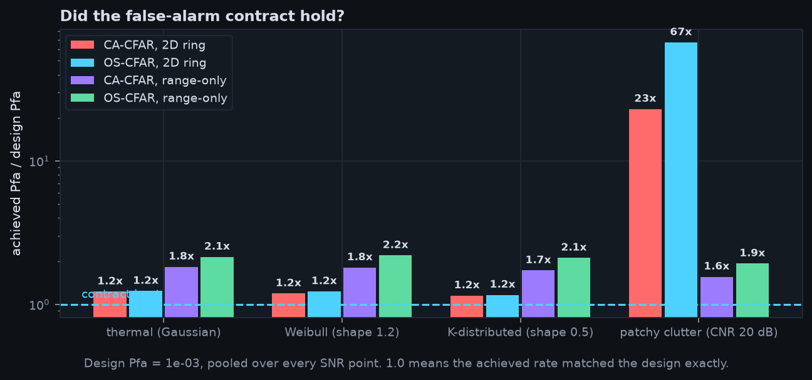
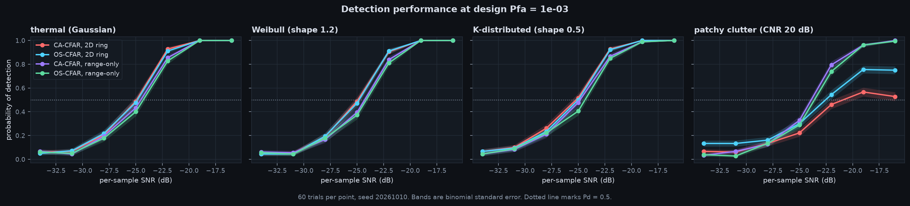
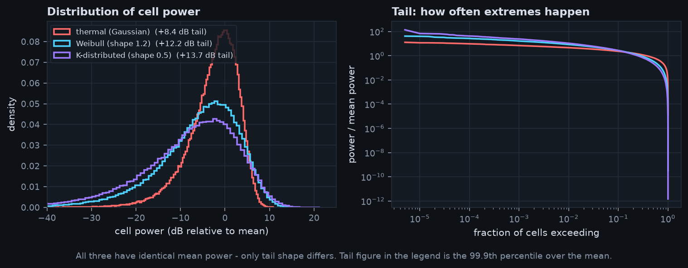
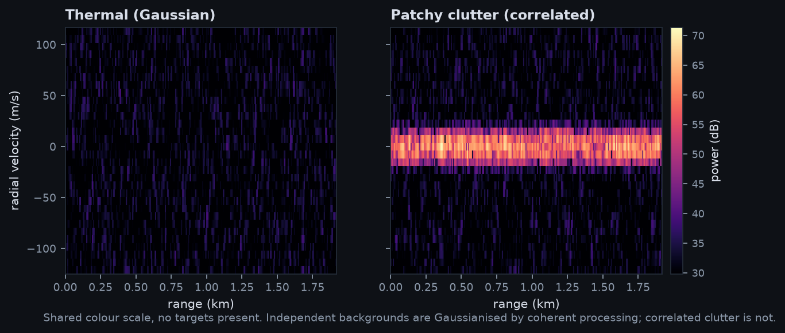

# Characterisation report

Generated by `scripts/characterize.py`. Do not edit by hand.

- date: 2026-10-10
- seed: `20261010` (fully reproducible)
- trials per point: 60
- design Pfa: 1e-03
- python 3.14.0, numpy 2.5.3

## Configuration

```
carrier             3.00 GHz (lambda 10.0 cm)
bandwidth           10.0 MHz
pulse width         5.0 us (B*T = 50)
PRI                 200 us (32 pulses = 6.4 ms dwell)
grid                32 Doppler x 256 range = 8192 cells
range resolution    15.0 m (bins 7.5 m, swath 1.92 km)
velocity resolution 7.81 m/s (unambiguous +/-124.9 m/s)
processing gain     33.2 dB (20.0 compression + 13.2 integration)
```

## Did the false-alarm contract hold?

A CFAR detector promises a constant false-alarm rate. This table asks
whether each one delivered it. Pooled over every SNR point, since Pfa
is a property of the detector and background, not of the targets.

| Background | CA-CFAR, 2D ring | OS-CFAR, 2D ring | CA-CFAR, range-only | OS-CFAR, range-only |
|---|---|---|---|---|
| thermal (Gaussian) | 1.2x | 1.2x | 1.8x | **2.1x** |
| Weibull (shape 1.2) | 1.2x | 1.2x | 1.8x | **2.2x** |
| K-distributed (shape 0.5) | 1.2x | 1.2x | 1.7x | **2.1x** |
| patchy clutter (CNR 20 dB) | **23x** | **67x** | 1.6x | 1.9x |

Values are achieved Pfa divided by design Pfa. 1.0 is a kept promise;
**bold** marks a detector that broke its contract by 2x or more.



## Detection performance



> **Read these with the table above.** Pd is only comparable between
> detectors that achieved the *same* false-alarm rate. A detector whose
> Pfa ran 30x hot is not more sensitive, it is just flagging more cells;
> its curve sits higher for a reason that has nothing to do with skill.

| Background | Detector | -34 dB | -31 dB | -28 dB | -25 dB | -22 dB | -19 dB | -16 dB |
|---|---|---|---|---|---|---|---|---|
| thermal (Gaussian) | CA-CFAR, 2D ring | 0.06 | 0.07 | 0.21 | 0.49 | 0.93 | 1.00 | 1.00 |
| thermal (Gaussian) | OS-CFAR, 2D ring | 0.05 | 0.07 | 0.22 | 0.48 | 0.91 | 1.00 | 1.00 |
| thermal (Gaussian) | CA-CFAR, range-only | 0.07 | 0.04 | 0.19 | 0.43 | 0.86 | 1.00 | 1.00 |
| thermal (Gaussian) | OS-CFAR, range-only | 0.06 | 0.05 | 0.18 | 0.40 | 0.83 | 1.00 | 1.00 |
| Weibull (shape 1.2) | CA-CFAR, 2D ring | 0.04 | 0.05 | 0.19 | 0.49 | 0.91 | 1.00 | 1.00 |
| Weibull (shape 1.2) | OS-CFAR, 2D ring | 0.04 | 0.04 | 0.19 | 0.47 | 0.91 | 1.00 | 1.00 |
| Weibull (shape 1.2) | CA-CFAR, range-only | 0.06 | 0.06 | 0.17 | 0.39 | 0.84 | 1.00 | 1.00 |
| Weibull (shape 1.2) | OS-CFAR, range-only | 0.06 | 0.04 | 0.18 | 0.37 | 0.81 | 1.00 | 1.00 |
| K-distributed (shape 0.5) | CA-CFAR, 2D ring | 0.07 | 0.10 | 0.26 | 0.52 | 0.93 | 1.00 | 1.00 |
| K-distributed (shape 0.5) | OS-CFAR, 2D ring | 0.07 | 0.09 | 0.23 | 0.50 | 0.92 | 1.00 | 1.00 |
| K-distributed (shape 0.5) | CA-CFAR, range-only | 0.04 | 0.08 | 0.21 | 0.48 | 0.87 | 0.99 | 1.00 |
| K-distributed (shape 0.5) | OS-CFAR, range-only | 0.04 | 0.09 | 0.22 | 0.41 | 0.85 | 0.99 | 1.00 |
| patchy clutter (CNR 20 dB) | CA-CFAR, 2D ring | 0.07 | 0.06 | 0.13 | 0.22 | 0.46 | 0.57 | 0.53 |
| patchy clutter (CNR 20 dB) | OS-CFAR, 2D ring | 0.13 | 0.13 | 0.16 | 0.30 | 0.54 | 0.76 | 0.75 |
| patchy clutter (CNR 20 dB) | CA-CFAR, range-only | 0.03 | 0.07 | 0.13 | 0.33 | 0.79 | 0.96 | 1.00 |
| patchy clutter (CNR 20 dB) | OS-CFAR, range-only | 0.04 | 0.03 | 0.13 | 0.29 | 0.74 | 0.96 | 0.99 |

## Why the backgrounds differ





## Findings

1. **Independent heavy tails did not survive the processing chain.** Across Gaussian, Weibull and K-distributed backgrounds, no detector exceeded 2.2x its design false-alarm rate, even though the K-distributed background is far spikier than Gaussian at the input. Pulse compression sums about a hundred samples and the Doppler FFT sums the pulses; adding that many independent values drives the result toward a Gaussian whatever went in. A heavy tail that is independent cell to cell is averaged away before any detector sees it.

2. **Correlated clutter broke both estimators.** With clutter that persists across a dwell and spans neighbouring range cells, the 2D training ring produced CA-CFAR, 2D ring at 23x, OS-CFAR, 2D ring at 67x the design rate. Correlation is what lets a heavy tail survive coherent processing, and it is the realistic case.

3. **The order statistic was the *worse* choice here, not the better one.** OS-CFAR, 2D ring was the worst performer at 67x. The textbook argument for OS-CFAR is that a median-like statistic resists outliers, which is true in range. But this clutter occupies only a few Doppler bins, so a training ring thirteen cells tall samples mostly clutter-free cells. The order statistic reads that quiet majority and sets a threshold far too low for a cell sitting inside the ridge. A mean, dragged upward by the bright cells, happens to fail less badly.

4. **The 2D ring masked targets permanently, not just at low SNR.** At the strongest signal swept, the 2D-ring detectors plateaued at Pd 0.53 (CA-CFAR, 2D ring), Pd 0.75 (OS-CFAR, 2D ring), while the range-only versions reached 1.00, 0.99. A training ring tall enough to reach across the clutter ridge picks up ridge cells as 'background' for a target that is nowhere near it, and inflates that target's threshold beyond anything its own echo can clear. More transmit power would not fix it; the target is masked by the detector's own geometry.

5. **Training geometry mattered more than the choice of statistic.** Restricting the training cells to the cell under test's own Doppler bin - so every training cell experiences the same clutter level - brought both detectors back to 1.6x, 1.9x. That is a larger effect than the difference between the two estimators, and it is the configuration real surveillance radars use. The lesson is that *where* a detector looks for its background matters more than *how* it summarises what it finds.

